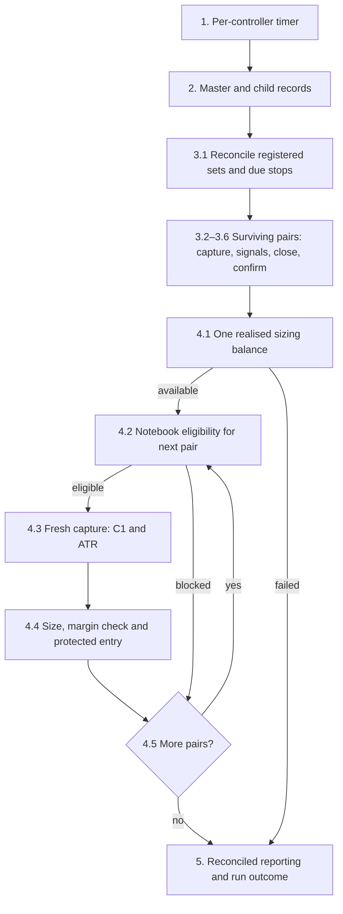

# Architecture and presentation

The owner-approved architecture implements the [brief](../PROJECT_BRIEF.md).
Design and plan reviews completed on 16 November 2026. This document owns runtime
boundaries, workflow numbering, candle/signal contracts and dashboard presentation; it does not establish
account support or observed deployment. See [status](STATUS.md) for those facts.

## Runtime and deployment

Use one Python master process per controller, calling Manage Open Trades and
Manage New Trades sequentially. A child is a recorded stage, not another worker.
The master owns its run identity, binding, broker client and notebook connection.
Independent accounts may run concurrently, each with one SQLite notebook and
one systemd service instance. Avoid queues, a reconciliation daemon and research
framework dependencies.

The target is Ubuntu `thinkbook-server`: a private Python environment, per-controller
oneshot service/timer templates and a separate Flask/Jinja/Waitress dashboard.
The timer owns the brief's New York schedule, DST and missed-launch behaviour;
[operations](OPERATIONS.md#installed-layout-and-scheduling) owns exact host settings,
permissions, maintenance and deployment procedures. Clock, dispatch and wakefulness
need observations, not assumptions from unit files.

A small HTTPS client pins the practice host/account, reuses connections and applies
bounded timeouts. Account-wide reliable reads and durable notebook writes are
required to continue mutations. Coordinate read traffic against the broker limits
when qualifying a deployment; measured run duration informs any later schedule
review, not an implicit timing change.

## Numbered workflow

| Step | Component responsibility |
| --- | --- |
| 2 | `master` validates binding and records the run and both stages before account work. |
| 3.1 | `manage_open` loads registered sets, both expected legs and unresolved evidence; reconciles actual activity and due stop-to-entry actions. |
| 3.2–3.6 | For each surviving pair in brief order: capture, calculate independent Exit/C1 events, record triggers, close eligible legs and commit outcomes before advancing. |
| 4.1 | `master` obtains the immutable sizing balance after a finished Stage 1, including isolated unresolved closes. Fatal Stage 1 failure prevents entry. |
| 4.2–4.5 | `manage_new` visits all 28 pairs in order; blocked pairs skip before pair requests. Eligible pairs use a new capture, fresh C1/ATR and candidate entry, finishing each outcome before the next. |
| 5 | `master` imports through the final account boundary, records reporting refresh and finishes the run; failed refresh retains the last successful snapshot. |

The [design](DETAILED_DESIGN.md#run-and-commit-contracts) owns commit and failure
semantics. The diagram abbreviates invalid-input/no-event skips; it does not
require an entry for every capture or final broker work after a fatal failure.

## Configuration and reuse boundaries

The public registry binds stable controller/notebook IDs, display name, strategy
version and private connection key. Private fields and immutable validation are
specified in [design](DETAILED_DESIGN.md#configuration-and-records). One account has
one entry controller; new strategies use new accounts and notebooks. A token may
access multiple subaccounts, so each request still pins the configured account.

SQLite WAL and short transactions let the separate reader see committed progress
without trading privileges. UTC and broker precision are retained at rest;
New York dates/offsets govern display and sessions. Decimal arithmetic surrounds
the lab's unchanged numerical calculations. Ordinary candle windows stay in memory.

Package only the manually selected lab conversions, pure helpers and exact
transitive dependencies with manifests/provenance. Runtime never imports the
sibling checkout or operating database. Offline identical-input comparison may
read them. [Calculation contracts](#candle-and-signal-inputs) own
ATR/event/history details; [Python 02](PYTHON_02.md) and [Python 03](PYTHON_03.md)
own experiment-specific integration decisions.

## Candle and signal inputs

Qualify the shortest sufficient rolling count for warm-up, prior events and ATR,
including sensitivity to recursive initialization. Anchored mode follows its bound origin.
Both stages use one capture function: daily mid prices, `smooth=false`,
`dailyAlignment=17`, `alignmentTimezone=America/New_York`, exact bound `count`.
Require ordered, nonduplicate, aligned valid OHLC; all preceding bars completed;
final candle incomplete and due to end at 17:00 on the run's New York date.
A response at/after rollover, completed-only/next-session response or wrong count
is unavailable; no padding, shortened window or older-candle fallback. Resolve
sessions with New York DST/weekends, not fixed UTC-day subtraction. A valid capture
continues to supply that stage's actions even if execution later crosses rollover.

Record request/response times, received count, signal start, intended session and
validation result. Ordinary windows stay in memory; retained qualification candles
are separate evidence. Stage 2 receives neither Stage 1's event nor former direction:
its own fresh C1 determines entry once flat/clear. A broker closure not yet reconciled
can leave the pair conservatively skipped for this run.

Results distinguish `long`, `short`, `no_event`, `unavailable` and errors. Save
current/prior operands and rule IDs. Preserve lab equality/missing-value/transition
helpers and reject invalid simultaneous directions without invented precedence.
Evaluate C1/Exit independently; one valid opposite event remains actionable when
the other or ATR is unavailable. Retain true-range candidate order, nine-decimal
half-away-from-zero comparisons, first full-precision winner on ties and `math.fsum`
simple ATR(14). Lift only the research fixed-length guard. ATR needs at least 15
bars; use a round-trippable decimal string only at the sizing boundary.

The optional manifest `history_initialization` has `mode=anchored`, exact UTC
`start`, `calendar=new_york_weekdays`. Raw capture still requires the exact count.
Only this mode accepts completed Friday/Saturday-start bars in raw history; remove
them from the indicator suffix starting at the mandatory origin. Require at least
15 retained bars; the final partial never receives that exception. Record
`indicator_history_start`, `indicator_candle_count`, `excluded_non_session_candles`.
C1, Exit and sizing ATR use the same suffix. Missing origin fails; no persistent
candle/state store is introduced. Other strategies retain rolling initialization.

[Lab ATR standard](../../nnfx-indicator-lab/docs/standards/ASSESSMENT.md#true-range-and-atr)
and [signal helpers](../../nnfx-indicator-lab/nnfx/signals.py) are source references;
selected manifests pin the exact versions used at runtime.

## Notebook dashboard

This is the authoritative presentation contract, moved from detailed design.
The brief owns required [journal fields and pip rules](../PROJECT_BRIEF.md#notebook-and-observational-dashboard);
[design accounting](DETAILED_DESIGN.md#monetary-records) owns totals and cutoffs.
The reference is the existing [indicator lab dashboard](http://192.168.51.10:8877/).
Use simple server-rendered navigation, labels, tables and native disclosures.

| GET view | Contract |
| --- | --- |
| `/controllers` | Account freshness/issues, latest master and two stages, committed progress and metadata-only previous history. |
| `/controllers/<controller_id>/runs/<run_id>` | Details loaded on demand from that registered controller's notebook; unknown IDs cannot select another notebook. |
| `/notebooks` | Notebook/journal link, account figures at one reporting snapshot, linked controller and immutable strategy/rules. |
| `/notebooks/<id>` | Account figures, every recorded trade leg in one filtered table, full selected records/fills, issues, requests, activity and strategy/lifecycle details. |

### Controller presentation

The owner accepted the account-first layout and wording changes on 20 November.
Lead with notebook name, secondary controller identity, account freshness and open
issues, then latest run and two stacked stages. Empty issues use one line. Keep
failed/stale refreshes, latest failed checks and unfinished decisions visible.

Stage 1 separates reconciliation from surviving-pair progress; Stage 2 reports
outcomes out of 28. Counts derive from committed final pair outcomes, including
failed/unavailable checks and excluding unfinished decisions. Label progress
“checked”. Entry `skipped` means “with no entry”, with its recorded reason;
management `skipped` means “exit check(s) unavailable”, never an invented absence
of required action. Completed empty management says “No open trades to manage”
and omits a zero-only outcome line.

“No new entries” requires a completed entry stage, all expected pairs skipped and
no set recorded for that run. “Account records matched to broker” requires the
stage's referenced snapshot to be reconciled. These labels describe saved records,
not current service liveness. Show actual skip reasons rather than assuming no signal.

Place “Previous run history” immediately after latest “Run and reconciliation
details”, before account-data details. Exclude the latest run, show the prior-run
count and an empty message where applicable. Older rows contain dates, status,
duration, invocation mode and error/unfinished indicators. Expand the history
list by default when it contains problems. Each link opens a separate tab/window
according to browser preference. Do not embed or prefetch historical stages,
decision reasons or reconciliation records in the controller request.

Latest and historical details retain full IDs, exact timestamps/durations,
current/last steps and pairs, reconciliation and resolved issues in native
expandable sections. Readable duration rounding never changes stored values.
Plain labels accompany exact issue codes and operator responses.

### Notebook overview and journal

Use account-first order: name/journal link, freshness/warnings/open-issue count,
then balance and separate realised profit/loss at the common reporting snapshot.
Show the reporting period. Before activation label qualification figures and
leave ordinary figures unavailable; after activation lead with ordinary figures
and disclose capped qualification results separately. Latest saved-run status
and controller link follow. Keep strategy version, count and indicator names
visible, with full rules/parameters and exact snapshot identities/times in details.

Balance is neutral, without a profit-style plus sign. Signed result text uses
green/red for positive/negative, neutral zero and thousands separators without
dropping recorded monetary precision. Journal summary adds unrealised result;
financing, other charges and balance components remain distinguishable disclosures.
Missing amounts stay unavailable rather than zero.

The owner specified one trade table and filters on 25 November. Include open,
closed, confirmed-not-opened and unconfirmed/planned legs. Default to newest sets
first, adjacent Trade 1/Trade 2 rows with their shared set ID. Preserve all brief
fields plus initial/current units, stop-to-entry status, distinct charges and
original/current protection evidence. Planned legs have no invented fills or IDs.

Read-only GET filters combine search, pair, status, direction, reporting period
and inclusive New York entry dates. Show matching/total counts; clear restores
all records. Invalid choices/ranges show an error, not unfiltered output. Filters
never recalculate account summaries. Search understands displayed exit labels
and original broker codes. Stored and searched text is escaped.

Table columns show prices, units, protection, outcomes, charges and IDs. Allow
horizontal scrolling on all screen sizes, pin pair/leg identity horizontally and
headers vertically. Closed protection is inactive; it must not be labelled as a
missing active stop or an unconfirmed planned target. Open/unconfirmed protection
and failed/unknown stop-to-entry outcomes retain warnings.

Each row links, with selected filters preserved, to its full record and fills
below the table. Resolve selections only inside the selected notebook. The
selected record opens as a native disclosure with identifiers, exact broker times,
original/current protection, final exit evidence, charges and raw reason/stop codes
beside readable labels. Distinguish still open, not opened, unconfirmed and missing
values. Explain phases, paired trades, units and filters versus totals in expandable
help; headings reflect journal sections.

Entry/exit table dates use day, abbreviated month and year on one line; the second
shows 24-hour New York time, timezone abbreviation and UTC offset. Omit fractional
seconds from table text only: preserve the full broker timestamp in the time
element, tooltip and expanded record. Browser timezone never alters trading dates.

Activity and request outcomes follow trades in disclosures. Show a top warning
for activity newer than the account snapshot and expand that activity by default;
uncertain/unsuccessful requests also expand. Posted amounts stay separate from
informational allocations. Strategy and activation records follow. Presentation
never changes accounting or trading eligibility.

### Freshness, isolation and accessibility of records

All summary amounts share the last successful reconciled snapshot and refresh
time. Newer confirmed journal activity stays visible and explicitly labelled,
without entering summary totals until covered. Missing snapshots show unavailable
figures. Display refresh age, latest run and failed/unfinished refresh. A scheduled
weekday launch passed without a later snapshot makes the view stale; this causes
no catch-up run or broker polling.

Use short consistent read transactions, read-only SQLite with committed WAL
visibility, registry-allowlisted notebook IDs and a trusted-LAN listener. GETs
never create/migrate notebooks; missing, incompatible or unreadable notebooks show
an explicit error. The service has no private `.env`, broker client,
write connection, controller invocation or trading/configuration/disposition route.
Deployment permissions are separate from its runtime identity; the full
[deployment authority contract](OPERATIONS.md#dashboard-deployment-authority)
remains restricted to the reviewed dashboard allowlist.

## Integration evidence boundary

OANDA's documented requests support a candidate path, not proof for an account.
The design owns [sizing/order contracts](DETAILED_DESIGN.md#sizing-and-two-leg-entry);
[acceptance](ACCEPTANCE.md#account-and-execution-evidence) owns profile, conversion,
restrictions and actual execution checks. Native v20 client extensions, netting,
protected-size/FIFO rules and historical fill-relative protection need intended-account
evidence. Read-only preflight and strategy selection have dated results in
[verification](VERIFICATION.md); [status](STATUS.md) records operation and M10 removal.
