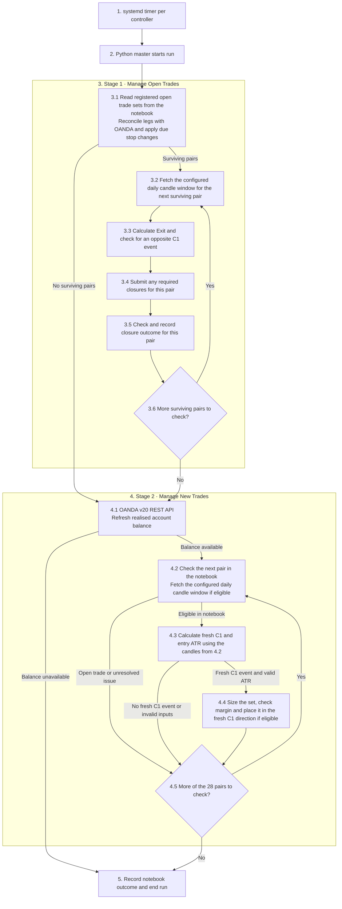

# NNFX Practice Lab architecture

The numbered workflow and the architecture refinements below incorporate
the owner's decisions. The [project brief](../PROJECT_BRIEF.md) owns the
trading and operating rules.



Steps 3.2–3.5 handle one surviving pair at a time. Step 3.3 calculates Exit and
C1 to determine whether to close the existing trades. Steps 3.4–3.5 submit
the closures and record the outcome before 3.6 advances to the next pair.
After Stage 1, step 4.1 requests the balance once regardless of the
closure outcomes, including when Stage 1 had no surviving pairs. Once the
balance is available, step 4.2 checks each of the 28 pairs against the notebook
and requests fresh candles only for eligible pairs. Step 4.3 calculates fresh
C1 and ATR. Step 4.4 sizes and opens an eligible set in the fresh C1 direction.
Both stages record progress and errors in SQLite for the dashboard.

## Runtime and deployment

The target host is the existing always-on Ubuntu `thinkbook-server`. Deploy a
Python virtual environment, one systemd oneshot service and timer template instantiated
per controller, and a separate dashboard service. Manage Open Trades and Manage
New Trades are modules called in sequence within the same master process.
The master owns the run identity, account binding and notebook connection.
Each stage records progress before advancing to the next pair. Independent
controllers can run concurrently against their own accounts and databases.
Use a small HTTPS client with connection reuse and request timeouts. Coordinate
read traffic within OANDA's published limits when qualifying the deployment.
[OANDA development guide](https://developer.oanda.com/rest-live-v20/development-guide/)

Set `OnCalendar=Mon..Fri *-*-* 16:50:00 America/New_York` to trigger the
controller's systemd service on weekdays at 4:50 pm New York time, including
daylight-saving changes. `AccuracySec=1s` gives systemd a one-second window
after the scheduled time to place the timer expiry. With `Persistent=false`,
the timer skips launches missed while it was inactive.
Start each account's controller through its single service to prevent
overlapping instances. The controller records start and finish times and
elapsed duration for review. Use `Restart=no` so a failed scheduled run ends
and the next timer launch starts a new run.
Use observed timings to inform any later schedule change. The dashboard runs
independently. Confirm the host stays awake through scheduled runs, its clock
is synchronised and the timer starts without an interactive login. The offline
calendar check is in [status](STATUS.md).
[systemd timer documentation](https://www.freedesktop.org/software/systemd/man/latest/systemd.timer.html) ·
[systemd service documentation](https://www.freedesktop.org/software/systemd/man/latest/systemd.service.html)

Dashboard releases are separate from the qualified trading installation. The
owner authorized a limited deployment command for `codexdev` on 20 November 2026;
the dashboard continues to run as `nnfx-view`. The
[deployment authority contract](DETAILED_DESIGN.md#dashboard-deployment-authority)
defines the permitted files, protected helper and rollback boundary. The
[installation status](STATUS.md#scoped-dashboard-deployment-access) distinguishes
prepared setup from an active host permission.

## Configuration and storage

Use one `config.toml` with a record per experiment. It binds a
stable controller ID, notebook ID and display name, versioned strategy reference
and a key identifying the account connection in a private `.env`. The `.env` holds
each practice account ID, token, home currency and candle lookback and has
owner-only permissions.
The owner accepts that a practice token may grant access to multiple subaccounts.
Pin the REST base URL to the practice host. Validate uniqueness of account,
controller and notebook IDs and match the returned account ID and currency to
the configuration.
[OANDA authentication](https://developer.oanda.com/rest-live-v20/authentication/)

Use one local SQLite file at `var/notebooks/<notebook-id>.sqlite3` per notebook.
A new experiment adds a configuration record, its private connection and a timer
instance. It uses the same code and creates a new database. Bind each database to
its original controller, notebook and broker account. The controller owns writes.
Use WAL, short transactions and a read-only dashboard connection.

The database holds these records:

- Strategy versions and research provenance, account binding, master and child
  runs, the effective candle lookback per run, durations and per-pair outcomes.
- Signal results, entry ATR, and sizing decisions linked to the pair, stage,
  run and strategy version. Record the signal candle timestamp and when it
  was fetched.
- Trade sets, legs, their original and current protective levels, order attempts
  and outcomes, and broker transaction, trade and order identities.
- Broker transactions and the reconciliation cursor, the 4.1 sizing balance
  and the latest reconciled account snapshot for the dashboard. Record fills,
  realised P/L, financing, commissions and other identifiable ledger entries.

Store timestamps in UTC for broker reconciliation. Use New York time for
scheduling, candle session dates and dashboard display, with the UTC offset
visible alongside displayed times. Preserve broker decimal strings and use
decimal arithmetic for prices, units and ledger amounts. Keep the lab's
numerical types and precision inside its calculations.

Bind each controller, run and trade set to the selected strategy version. A
strategy or signal rule change requires a new controller with a distinct
practice account and notebook. The existing controller manages its trades
under its original rules.

## Indicator reuse and decision inputs

Package a small, versioned copy of the selected lab calculations and their exact
transitive calculation dependencies with the practice application. Include the
input/output types, comparison helpers, accepted rule definitions and the pure
parts of the signal interpreter and ATR function. Record the source research
result and commit, conversion and dependency hashes, output bindings, accepted
C1 and Exit rule identities, and parameter values. Import reviewed calculation
code from this package at runtime. The package is self-contained and independent
of the lab checkout, operating database and research controllers. Strategy
selection remains manual.

The inspected implementation uses `assessment.py` for `true_range_and_atr` and
`interpret_signals`, `signals.py` for directional events, crossings and state
transitions, `comparisons.py` for numeric normalisation, and `interface.py` for
aligned calculation inputs and outputs. The lab compares true-range candidates
at nine decimal places with half-away-from-zero rounding, keeps the first full-
precision candidate on ties, and computes the simple 14-value mean with
`math.fsum`. Retain the calculation when lifting the lab's fixed 2,072-row
assessment guard. Use identical-input comparisons with the lab when qualifying
each notebook and strategy version. Include signal equality, missing operands,
ATR ties and initialization. The scheduled run uses the qualified code and
configured warm-up.
[Lab ATR standard](../../nnfx-indicator-lab/docs/standards/ASSESSMENT.md) ·
[Lab signal standard](../../nnfx-indicator-lab/docs/standards/SIGNAL_RULES.md) ·
[Lab Exit rules](../../nnfx-indicator-lab/docs/standards/EXIT_SIGNAL_RULES.md) ·
[Lab trade sequencing](../../nnfx-indicator-lab/docs/standards/EXIT_ASSESSMENT.md)

Use one candle-fetching function for both 3.2 and 4.2. Set one
`LOOKBACK_CANDLES` value per controller in its private `.env`, using the
connection prefix when controllers share a file, such as
`PRACTICE_A_LOOKBACK_CANDLES`. It is the total number of daily candles to request,
including the current partial candle. Set it to the shortest qualified window
that supports C1 and Exit warm-up, any prior observations their signal rules
use, and ATR. ATR(14) needs at least 15 total bars, which gives the oldest of
the 14 true ranges a previous close. Qualify C1 and Exit on that rolling window
because recursive indicators can depend on where initialization begins.

Bind the qualified candle count to the strategy version alongside the indicator
parameters and signal rules. At run start, validate the configured count against
that binding and record the effective count once on the master run. Both stages
use that count for each eligible pair's candle request. Treat a different count
as a strategy revision because it can change indicator output.

Evaluate crossings and transitions at the current partial candle. Where the
accepted rule compares two observations, the partial candle supplies the
current observation and the preceding completed candle supplies the prior one.
Use each stage's capture for its own calculations. Historical candles
initialize the calculation and supply comparison inputs. Evaluate C1 and Exit
independently. Missing or invalid entry ATR blocks sizing and leaves exits actionable.

Use `GET /v3/accounts/{accountID}/instruments/{instrument}/candles` with
`granularity=D`, `price=M`, `smooth=false`, `dailyAlignment=17` and
`alignmentTimezone=America/New_York` and the configured lookback as `count`.
Stage 1 requests candles for surviving registered pairs. Stage 2 makes a fresh
request after the notebook eligibility check. The signal candle must have
`complete=false` and belong to the session due to end at 17:00 New York time
on the run's local date. Use OANDA's candle start timestamp to identify the
session. If the response contains only completed candles or a partial candle
for the next session, record the intended partial candle as unavailable for
that pair and stage. Use the captured signal through that stage's broker actions.

Keep candle windows in memory for calculation and record the resulting
signals and decisions. Missing partial data or insufficient history makes
the affected signal unavailable. During practice qualification, check lookback
coverage in both stages and measure how many requested pairs yield the intended
partial candle before 17:00 New York time.
[OANDA pricing endpoints](https://developer.oanda.com/rest-live-v20/pricing-ep/) ·
[OANDA candle fields](https://developer.oanda.com/rest-live-v20/instrument-df/) ·
[OANDA price fields](https://developer.oanda.com/rest-live-v20/pricing-df/)

## Broker workflow

### Stage 1 · Manage Open Trades

Start 3.1 by reading the notebook's registered trade sets with an open leg. Group
them by pair and load each set's Trade 1 and Trade 2 records, including any
leg already marked closed. Reconcile these broker trade IDs against OANDA's
open trades and transactions. Import broker fills, closures and charges before
making changes.

- If Trade 1 is missing from OANDA's open trades, look up its closure. A
  confirmed take-profit on Trade 1 and a surviving Trade 2 call for moving
  Trade 2's stop to its own entry price. Use the same rule when the take-profit
  closure was already recorded in the notebook. If OANDA confirms the existing
  stop is already at Trade 2's entry price, record the adjustment as complete.
  Otherwise submit a due stop change and verify the new stop or an intervening
  closure. A prior failed or unresolved change remains with the operator.
- If both registered legs are missing, check each leg's closing transactions
  for stop-loss execution and record each actual outcome. The two legs may
  have closed for different reasons.
- If a missing leg has no confirmed closure, record it as unresolved. The
  absence of a trade ID from the open list is insufficient to establish when
  or why it closed.

Break-even stop changes use OANDA's dependent-order endpoint and can proceed
without candle data.

Process the pairs with surviving trades one at a time, in the brief's order.
For the current pair, fetch its partial daily candle and required history.
Calculate Exit and C1 to find any fresh opposite event requiring closure.
Record the events and surviving set state before any signal close. Use
`PUT /trades/{tradeSpecifier}/close` with `ALL` for each surviving broker trade ID,
then verify the actual closes. A trade queued by OANDA to close when tradeable
still occupies the pair. Record the
closure outcome for the current pair before advancing, including a confirmed
close, an unconfirmed close or that no closure was required. Record both reasons
when C1 and Exit agree on a close.
[OANDA trade endpoints](https://developer.oanda.com/rest-live-v20/trade-ep/)

### Stage 2 · Balance refresh, entry calculations and Manage New Trades

After Stage 1 finishes, request `GET /v3/accounts/{accountID}/summary` once and
save the actual account `balance`. Make the request for every completed Stage 1,
including on the first run and when a closure remains unconfirmed. Start the
new-entry loop once the balance is available. Use the saved balance for every
entry and reversal in the run. If the balance request fails, record the failure
and end the run before new entries.
[OANDA account summary endpoint](https://developer.oanda.com/rest-live-v20/account-ep/) ·
[OANDA account fields](https://developer.oanda.com/rest-live-v20/account-df/)

Visit each of the 28 permitted pairs in the brief's order. In 4.2, check the
reconciled notebook for any open leg or unresolved broker issue on the pair.
Record a blocked pair as skipped and advance to 4.5 without a pair-specific
OANDA request. An eligible pair gets a fresh candle window using the configured
lookback. Step 4.3 uses only the candles from 4.2 and the configured rules to
calculate C1 and entry ATR. Pass a fresh C1 event and valid ATR to 4.4.
Missing data, an absent or unavailable event, or invalid ATR advances to 4.5.

Stage 2 uses the notebook's registered trade state after Stage 1 and updates it
as broker responses confirm activity. This relies on the assigned controller
being the only source of new entries on the account. Operator intervention on
existing trades or orders takes place between runs. If a leg closes at the
broker after Stage 1 and the notebook still shows it open, this run skips the
pair. Step 4.4 uses the fresh C1 direction regardless of prior trade direction
or closure reason.
Use the balance from 4.1 for sizing. Fetch current bid/ask pricing and
`homeConversions` and confirm that the instrument is tradeable.

```text
risk budget per leg  = 0.01 × sizing balance
planned stop loss   = absolute units × executable stop distance × quote-to-home loss factor
```

Always use the quote currency's returned `accountLoss` from OANDA
`homeConversions`, requested with `includeHomeConversions=true`, including when
quote and home currency match; do not substitute a local factor. Verify the
expected home-currency factor of 1 under the account-preflight applicability
rules below.
Require a present, finite, positive factor and retain its currency, value and
response time with the sizing decision. The planned loss and risk budget use
the configured home currency. Order quantities use the traded pair's base
currency. Retain the raw ATR and quantise the 1.5 × ATR
stop distance to broker price precision before sizing. Round absolute units down
at `tradeUnitsPrecision` to stay within each leg's budget. Check instrument size
limits, executable price precision and the protection constraints. Skip the
entry if conversion is missing/invalid or allowed units fall below the minimum.
Record the planned inputs and the actual fills separately.
[OANDA instrument metadata](https://developer.oanda.com/rest-live-v20/primitives-df/) ·
[OANDA home conversions](https://developer.oanda.com/rest-live-v20/pricing-df/)

Fetch current `marginAvailable` from the OANDA account summary before each
set. Estimate the requirement for both legs from base units, the base-to-home
`positionValue` conversion (1 when the currencies match), and the instrument
margin rate with any applicable account override. Recheck remaining margin
before sending Trade 2. OANDA decides whether to accept each order. OANDA
marks the `unitsAvailable` pricing field deprecated. The brief sets no
combined account risk cap.
[OANDA account fields](https://developer.oanda.com/rest-live-v20/account-df/) ·
[OANDA v20 margin examples](https://help.oanda.com/us/en/faqs/margin-examples.htm) ·
[OANDA pricing parameters](https://developer.oanda.com/rest-live-v20/pricing-ep/)

#### Two-trade entry and protection

1. Commit the local set ID, both expected legs and their required protection
   before sending the first order. Commit each broker order attempt before
   sending it. Submit Trade 1 as a market order with `FOK`, `OPEN_ONLY` and a GTC
   `stopLossOnFill.distance`. Use the documented native v20 order and trade
   client extensions to identify the attempt. Confirm the newly opened trade,
   units, actual fill and attached stop from broker records. Commit those
   confirmed results before requesting the target.
2. Calculate Trade 1's take-profit price from its actual fill plus one signal ATR
   for a long or minus one signal ATR for a short. Round to the nearest valid
   price tick, preserving the correct side, and set the GTC `takeProfit` through
   `PUT /trades/{tradeSpecifier}/orders`. That request omits `stopLoss` so the
   existing stop remains active. OANDA's take-profit details expose a price field
   only, so there is a brief interval with a stop and no target. Verify the actual
   target before proceeding. A move through the desired target during that
   interval is a protection setup failure if OANDA rejects the target. Commit
   the confirmed target before sending Trade 2.
3. Check that Trade 1 still survives with both orders, then submit Trade 2 with
   the same market/stop mechanism and no target. Use the broker transaction
   sequence and current trade records to confirm both distinct fills, their
   initial stops and Trade 1's target. Commit the confirmed results before
   advancing to the next pair. If both legs and their protection were
   established, a later broker price exit is normal trade management. If a
   leg closes before the two-trade set is established, record the incomplete
   set and the actual fill and closure.

These are documented API mechanisms. In particular, `StopLossDetails.distance`
is documented relative to the trade open price, and the resulting stop must be
verified at executable precision. Qualification must prove this, target placement
and replacement, targeted closures and the intended account's two-leg behaviour.
[OANDA order requests](https://developer.oanda.com/rest-live-v20/order-df/) ·
[OANDA order responses](https://developer.oanda.com/rest-live-v20/order-ep/) ·
[OANDA protection details](https://developer.oanda.com/rest-live-v20/transaction-df/) ·
[OANDA trade endpoints](https://developer.oanda.com/rest-live-v20/trade-ep/)

### Scheduled reconciliation and failure reporting

Record an account snapshot and transaction baseline when activating the dedicated
practice account. After loading the notebook's open trade sets in 3.1, read
current broker trades and pending orders and import broker activity with
`/transactions/sinceid`. Use transaction pages or ID ranges for
larger reads. Apply transactions by broker ID and advance the cursor only through
activity committed to SQLite in the same transaction. Reconcile through the
snapshot's transaction ID before using it for trade management. Use actual trade
IDs to manage each registered leg. Record unexpected broker trades or orders
as unresolved issues on their pairs and leave them for the operator.
[OANDA account endpoints](https://developer.oanda.com/rest-live-v20/account-ep/) ·
[OANDA transaction endpoints](https://developer.oanda.com/rest-live-v20/transaction-ep/)

Before a request that changes an order or trade, commit an attempt with its
purpose, requested values, and available broker or client IDs. Save the outcome
and response `RequestID` when available before issuing the next broker change.
An order is unresolved when the
controller lacks a confirmed outcome. A connection timeout after sending an
entry request can leave it unclear whether OANDA received, filled or rejected
it. Another order could duplicate a fill that already occurred. An attempt
left unfinished after a crash can have the same uncertainty. A 2xx response
can describe a cancellation or an order awaiting fill. Use broker evidence
to report the status of the request and trade.
[OANDA order responses](https://developer.oanda.com/rest-live-v20/order-ep/) ·
[OANDA transaction definitions](https://developer.oanda.com/rest-live-v20/transaction-df/)

Record each pair's outcome before advancing. Missing candle or pricing inputs,
an occupied pair and insufficient margin produce a skip with its reason. A
rejected order or an unresolved close, entry or protection change produces a
failure with the available evidence. Continue with the other pairs when
account-wide reads and notebook writes remain usable. If the controller loses
reliable account state or cannot write the notebook, end the run and surface
the failure. An abrupt stop can leave the master, child or broker attempt
unfinished.

An interrupted entry with a confirmed fill and outstanding legs or protection
remains incomplete even if the controller stopped between requests. The saved
set identifies what was expected, and the confirmed broker records identify
what happened. The pair stays blocked for new entries pending operator
disposition.

The operator resolves uncertain orders, incomplete sets and failed protection
changes in OANDA. A local notebook maintenance action records the disposition
and its broker evidence before clearing the entry block for that pair. Later
scheduled runs read and record broker activity normally. Automatic retries,
repair orders and replacement legs are outside this release.

### Step 5 · Finish the run

On normal completion, read the final broker account state and reconcile
transactions through its transaction ID. Save the resulting balance, unrealised
P/L and refresh time for the notebook alongside the final master and child
outcomes. The end-of-run snapshot is for reporting. Step 4.1's sizing balance
stays attached to the run and its entry decisions. If the final read fails,
show the refresh failure and the last successful snapshot with its timestamp.
Persisted order outcomes are still available for the dashboard.
[OANDA account endpoints](https://developer.oanda.com/rest-live-v20/account-ep/) ·
[OANDA transaction endpoints](https://developer.oanda.com/rest-live-v20/transaction-ep/)

## Notebook dashboard

Use a small Flask/Jinja application with GET views over read-only notebook files.
Deploy it on a separate port on the trusted LAN, following the reference lab's
server-rendered navigation, progress counts, status labels and tables. Read
the ordinary controller/notebook registry and SQLite. The controller service
owns OANDA access and loads the private `.env`. The dashboard reads committed
records. [Indicator lab dashboard reference](http://192.168.51.10:8877/)

- **Controller** shows master runs and both stages with duration, outcomes,
  skips and outstanding failures. Stage 1 reports reconciliation and the
  surviving pairs handled. Stage 2 reports pairs processed out of 28. A pair
  counts as processed once its outcome is recorded, including a skip or failure.
  An unfinished master or child stays visible after an abrupt stop.
- **Notebooks** shows the configured notebook, linked controller, strategy and
  signal rules, account balance, and realised profit and loss separately.
- **Notebook detail** shows the latest reconciled balance, unrealised result,
  strategy and broker refresh time. The trade table includes every field in
  the brief. Use per-trade broker fill prices and timestamps. For broker
  reductions, retain each fill and
  use the weighted exit price and final closing time for the completed trade.
  Calculate signed pips with `10 ** pipLocation`. Open trades have no realised exit
  outcome. Apply green/red to positive/negative values alongside signed text.
- Use realised amounts in the account's home currency from broker fills.
  Reconcile daily financing, commissions, other charges and cash adjustments as
  distinct ledger entries. Attribute amounts where the broker supplies an allocation.
  Use posted amounts once, with spread already reflected in execution prices.
  Display the last successful broker refresh and flag stale data if the latest
  run failed to refresh it.
  [OANDA transaction definitions](https://developer.oanda.com/rest-live-v20/transaction-df/)

## Integration evidence and review items

- **Documentation checked.** OANDA publishes the v20 practice REST host, bearer
  authentication, account instrument discovery, candle parameters, trade-level
  orders and changes, and transaction history. Account details expose currency,
  balances, margin and `hedgingEnabled`. The latter alone does not prove this
  strategy's same-direction two-leg execution. OANDA also says MT4-associated
  accounts should avoid client extensions, and documents a unique-size rule for
  protected trades at OANDA Corporation, including demo accounts. If that rule
  applies, review using one permitted unit increment less on Trade 2 within the
  per-leg budget. Confirm both legs can still be protected and closed by ID.
  [OANDA development guide](https://developer.oanda.com/rest-live-v20/development-guide/) ·
  [OANDA account fields](https://developer.oanda.com/rest-live-v20/account-df/) ·
  [OANDA order definitions](https://developer.oanda.com/rest-live-v20/order-df/) ·
  [OANDA FIFO guidance](https://help.oanda.com/us/en/faqs/fifo-requirement.htm)
- **Account evidence pending.** Identify the intended dedicated v20 practice
  account, OANDA division and private connection. Prefer a native v20 account
  that supports the proposed client extensions. Read-only preflight should verify
  authentication, account identity, configured home currency, actual balance,
  existing trades and orders, instrument metadata for all 28 pairs, pricing,
  conversions and the weekday 16:50 candle captures. Retain pricing responses
  requested with `includeHomeConversions=true` for permitted pairs, including
  cross-currency quotes: verify each requested quote currency's `accountLoss`
  is present, finite and positive. Require a live matching-quote case only when
  a permitted pair has the home currency as its quote; otherwise record that
  case as not applicable with the account currency and reason. Verify the home
  currency's returned `accountLoss` is exactly 1 whenever it appears as base or
  quote in a permitted pair (for example, the EUR entry from EUR/USD for an EUR
  account). If it appears in none, record that live identity-factor check as
  not applicable too. These applicability records do not block activation;
  missing/invalid required conversions or a non-1 home-currency factor where
  expected do. Retain the controlled matching-quote test for every configuration.
  Keep qualification activity identifiable separately.
- **Execution evidence pending.** On the intended account, observe two separately
  identified same-direction trades, fill-relative stops, Trade 1's fill-relative
  target, a move of Trade 2's stop to its own entry, targeted closes and ledger
  reconciliation. Exercise long and short paths and a cross-currency pair.
  Compare estimated margin with broker margin and verify account-specific price
  precision, protected-size and close restrictions. Any incompatibility with
  the brief goes to review before activation.
- **Strategy qualification pending.** Select the first C1/Exit combination
  manually before activation. Qualify its warm-up and calculation equivalence.

The [acceptance checklist](ACCEPTANCE.md) covers timing and signals in A01–A03,
sizing and sequencing in A04–A10, broker records and failures in A11–A14, and the
dashboard and account isolation in A15–A16. Controlled checks and an observed
practice run remain required. See [project status](STATUS.md) for completed checks
and the stage review.
